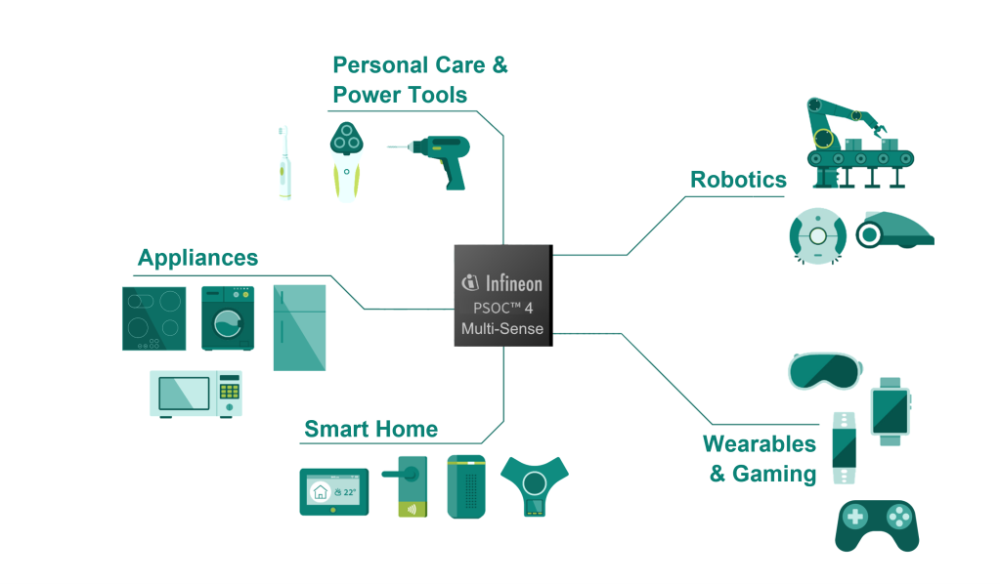

# PSOC™ 4 Multi-Sense Training

Learn to build low-power sensing applications with the fifth-generation Multi-Sense Converter with Low-Power (MSCLP) on PSOC™ 4000T and PSOC™ 4100T Plus. Start with capacitive sensing, then focus on inductive or liquid-level sensing, or continue into advanced test libraries.

<p align="center"></p>

## Access the training material

Use the course links below to open each training directly on Infineon GitHub. All six course repositories are also included under `courses/` as Git submodules. To clone the complete collection, use:

```sh
git clone --recurse-submodules https://github.com/luisreynosoIFX/mtb-training-psoc-multi-sense.git
```

If you already cloned the hub without submodules, initialize them with:

```sh
git submodule update --init --recursive
```

## Get started

New to PSOC™ 4 MSCLP? Start with common peripheral concepts, then continue with CAPSENSE™ and choose the sensing path that fits your application:

1. [PSOC™ digital peripherals training](https://github.com/Infineon/mtb-training-psoc-digital-peripherals) — Build a foundation in project creation and common peripherals, including GPIO, UART, SCBs, TCPWMs, interrupts, SysTick, and WDT across PSOC™ 4, PSOC™ 6, and PSOC™ Edge.
2. [PSOC™ 4 CAPSENSE™ training](https://github.com/Infineon/mtb-training-psoc-4-msclp-capsense) — Learn the MSCLP fundamentals and practice capacitive sensor performance and low-power tuning.
3. Choose a sensing specialization:
   - [Inductive sensing (ISX)](https://github.com/Infineon/mtb-training-psoc-4-msclp-inductive) — Explore fly-back sensing, sensor design and construction, reliability, and manual and SmartSense™ tuning.
   - [Liquid Level Sensing (LLS)](https://github.com/Infineon/mtb-training-psoc-4-msclp-lls) — Learn liquid-level calibration and foam rejection through hands-on labs.

## Dive deeper: testing and safety

These advanced trainings build on PSOC™ 4 and CAPSENSE experience:

- [CAPSENSE™ built-in self-test (BIST)](https://github.com/Infineon/mtb-training-psoc-4-msclp-bist) — Understand CAPSENSE middleware self-tests, when to run them, and how to execute them at startup or periodically during runtime.
- [Safety Test Library](https://github.com/Infineon/mtb-training-psoc-4-safety-test) — Explore functional-safety concepts and practice core peripheral, analog peripheral, and UART loopback tests using the PSOC™ 4 Safety Test Library.

## Training index

Browse the [PSOC™ 4 section of the ModusToolbox™ training catalog](https://github.com/luisreynosoIFX/training-modustoolbox) for these and other PSOC™ 4 trainings.